  

### Hi, I'm Gnaneshwar 👋

I build AI agents that do real work in healthcare, and I design them so a person approves every change they make.
Engineer at Genzeon: Claude Code agents connected through MCP, plus the monitoring and configuration that keep the servers honest.

### 🛠️ What I build

- **AI agents for testing.** A Claude Code manager session routes work to specialised agents that test a web portal for 4 user roles in parallel (pytest, Playwright, httpx). Read-only through MCP, SELECT-only databases, and nothing is written to Azure DevOps until I approve it.
- **Infrastructure monitoring.** Prometheus, Loki, Grafana Alloy and Grafana across on-premises and Azure hosts, with Teams alerts by severity and Claude querying it all through a Grafana MCP server.
- **Infrastructure desired state.** Puppet with Hiera and r10k, changes rolled out from a test node through rollout rings, and drift corrected on every run.
- **Automation in the open.** [linkedin-post-pipeline](https://github.com/gnaneshwar151120/linkedin-post-pipeline): approval-gated LinkedIn publishing with GitHub Actions, the LinkedIn API and Playwright-rendered carousels.

### 🧰 Stack

 

 

### 🏅 Certifications

[-0078D4?style=flat-square)](https://learn.microsoft.com/api/credentials/share/en-us/GnaneshwarVemunuri-6323/36267E1DD081B265?sharingId=1AA5DCDAAAC74ED5)
[-0078D4?style=flat-square)](https://learn.microsoft.com/api/credentials/share/en-us/GnaneshwarVemunuri-6323/CAFCE9496F3B5FB4?sharingId=1AA5DCDAAAC74ED5)

Plus [6 Grafana Labs certifications](https://www.credly.com/badges/693e71ee-2117-4c63-80f6-c07b7d9b39ee/public_url) (PromQL, LogQL, observability, dashboards).
Next up: Databricks Certified Data Engineer Associate.

### 🤝 Connect

I post every Tuesday (Linux, AlmaLinux-focused notes) and Thursday (AI agents, testing, data) on LinkedIn.
