<!-- Matrix-style profile. Visuals: assets/matrix/*.svg, built by scripts/matrix.py. Alternatives: README.city.md, README.gitskins.md -->

  

  
  

  

  

  

<code>[✓] verify the programs</code>

 

**Anthropic** · [Architect – Professional](https://www.credly.com/badges/17d1c9a0-7ccc-49f0-b228-44b1f1fac8e0) · [Architect – Foundations](https://www.credly.com/badges/c2a6ed2e-aa2f-4758-8048-ac8a6be5d3f1/public_url) · [Developer – Foundations](https://www.credly.com/badges/3aadd91f-a452-4041-9c50-1ce9f98c96a1/public_url) · [Associate – Foundations](https://www.credly.com/badges/f3f1cead-30d7-46a7-8aa3-0eb32c93f111/public_url) 
**Microsoft** · [AZ-900](https://learn.microsoft.com/api/credentials/share/en-us/GnaneshwarVemunuri-6323/36267E1DD081B265?sharingId=1AA5DCDAAAC74ED5) · [DP-900](https://learn.microsoft.com/api/credentials/share/en-us/GnaneshwarVemunuri-6323/CAFCE9496F3B5FB4?sharingId=1AA5DCDAAAC74ED5) · [GitHub Foundations](https://learn.microsoft.com/api/credentials/share/en-us/GnaneshwarVemunuri-6323/49FC274D52FC4761?sharingId=1AA5DCDAAAC74ED5) 
**Grafana Labs** · [Explorer](https://www.credly.com/badges/693e71ee-2117-4c63-80f6-c07b7d9b39ee/public_url) · [Trailblazer](https://www.credly.com/badges/8736a223-6bb0-460c-bbbe-6d1699d6fbc3/public_url) · [PromQL](https://www.credly.com/badges/0ead3966-1e31-46a5-9dad-5041d2426df7/public_url) · [LogQL](https://www.credly.com/badges/55b13637-9dab-4a79-b2a0-03d6a4028258/public_url) · [Dashboards](https://www.credly.com/badges/52fcf8b4-f69c-45ad-af21-1b847aadeed2/public_url) · [Observability Signals](https://www.credly.com/badges/71153f77-8d77-4dc5-af3d-e3c4214748b7/public_url) 
**Databricks** · [Fundamentals](https://credentials.databricks.com/1ef91652-d597-44b6-9be2-d8f2a02acfae)

  

<code>there is no spoon · only main</code>

