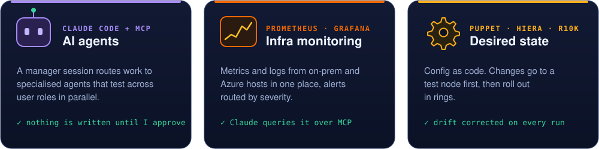
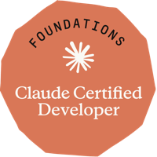
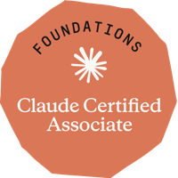

<p align="center">
  <a href="https://github.com/gnaneshwar151120?tab=repositories"></a>
</p>

<div align="center">

**🏙️ City directory** · click a building

| | |
|:--|:--|
| 🟩 **Automation & Infra** | [post-pipeline](https://github.com/gnaneshwar151120/linkedin-post-pipeline) · [almalinux-monitor](https://github.com/gnaneshwar151120/wsl-almalinux-monitoring) |
| 🟦 **Data Engineering** | [nyc-taxi-etl](https://github.com/gnaneshwar151120/pyspark-nyc-taxi-etl) · [sql-solutions](https://github.com/gnaneshwar151120/StrataScratch-SQL-solutions) · [ad-hoc-sql](https://github.com/gnaneshwar151120/AD_HOC) |
| 🟪 **Machine Learning** | [pca-images](https://github.com/gnaneshwar151120/Linear_Algebra_Meets_Images_PCA_for_compression_and_Feature_Extraction) · [card-churn](https://github.com/gnaneshwar151120/credit-card-cancellation-prediction) · [card-default](https://github.com/gnaneshwar151120/defaultcreditcard) |
| 🟧 **Analytics** | [insurance-claims](https://github.com/gnaneshwar151120/insurance-auto-claims-analysis) · [mental-health](https://github.com/gnaneshwar151120/Mental-Health-Care-in-the-Last-4-WEEKS) · [ipl-best-xi](https://github.com/gnaneshwar151120/BEST-XI-OF-IPL-2024) · [aqi-index](https://github.com/gnaneshwar151120/AQI_INDEX) |

</div>

<br>

### `01` whoami

```yaml
name:  Gnaneshwar Reddy
role:  Engineer @ Genzeon        # healthcare
build: [AI agents, infra monitoring, data pipelines]
rules:
  approval_required: true        # an agent's output is a draft until someone checks it
  read_only_first:   true        # look before you touch
  writers_per_system: 1          # one agent may write; the rest read, test and ask
```

### `02` what I build



### `03` certified

<p>
<a href="https://www.credly.com/badges/17d1c9a0-7ccc-49f0-b228-44b1f1fac8e0"></a>
<a href="https://www.credly.com/badges/c2a6ed2e-aa2f-4758-8048-ac8a6be5d3f1/public_url"></a>
<a href="https://www.credly.com/badges/3aadd91f-a452-4041-9c50-1ce9f98c96a1/public_url"></a>
<a href="https://www.credly.com/badges/f3f1cead-30d7-46a7-8aa3-0eb32c93f111/public_url"></a>
</p>

<details>
<summary><sub>+ 3 Microsoft · 6 Grafana Labs · Databricks</sub></summary>
<br>

[AZ-900](https://learn.microsoft.com/api/credentials/share/en-us/GnaneshwarVemunuri-6323/36267E1DD081B265?sharingId=1AA5DCDAAAC74ED5) · [DP-900](https://learn.microsoft.com/api/credentials/share/en-us/GnaneshwarVemunuri-6323/CAFCE9496F3B5FB4?sharingId=1AA5DCDAAAC74ED5) · [GitHub Foundations](https://learn.microsoft.com/api/credentials/share/en-us/GnaneshwarVemunuri-6323/49FC274D52FC4761?sharingId=1AA5DCDAAAC74ED5) · [Databricks Fundamentals](https://credentials.databricks.com/1ef91652-d597-44b6-9be2-d8f2a02acfae)<br>
Grafana Labs: [Explorer](https://www.credly.com/badges/693e71ee-2117-4c63-80f6-c07b7d9b39ee/public_url) · [Trailblazer](https://www.credly.com/badges/8736a223-6bb0-460c-bbbe-6d1699d6fbc3/public_url) · [PromQL](https://www.credly.com/badges/0ead3966-1e31-46a5-9dad-5041d2426df7/public_url) · [LogQL](https://www.credly.com/badges/55b13637-9dab-4a79-b2a0-03d6a4028258/public_url) · [Dashboards](https://www.credly.com/badges/52fcf8b4-f69c-45ad-af21-1b847aadeed2/public_url) · [Observability Signals](https://www.credly.com/badges/71153f77-8d77-4dc5-af3d-e3c4214748b7/public_url)

</details>

### `04` currently

```diff
+ building   AI agents that read, test and ask before they write
+ running    monitoring across on-prem and Azure hosts
+ writing    Linux notes every Tuesday, AI and data every Thursday
```

<br>

<p align="center">
  <a href="https://www.linkedin.com/in/gnaneshwar-reddy-59465b1b2/"></a>
</p>
